# Gaffer: Presenter script and demo kit

> One app that connects the owner’s books to the coach’s lineup.
>
> Audience: CEO review and investor-style demo. About 11 min + questions. 5:04 of demo clips, 18 screenshots.
>
> The same content, with the videos playable inline, is published as a web page. This file is the copy that lives with the code.

## How to use this

- Each section below has three parts: what to do on screen, what to say, and the media to show.
- The four demo clips are silent. Play them full screen and speak over them, using the “What to say” text as your guide. Pause any clip to take a question.
- Everything in the clips is the real app running in a browser, using the built-in demo club. The names, results and contracts are simulated.
- Where a clip fast-forwards the match clock, the clip says so on screen.

## Before you start

- [ ] Open this page and the full demo video (gaffer-full-demo.mp4) before the meeting. Test the sound-off playback and the full-screen mode.
- [ ] Keep the four individual clips handy in case you want to skip a scene or answer a question with one.
- [ ] Optional live demo: run the commands in the README (npm install, then npm run web) and tap “Load demo club”. Keep the videos as the fallback.
- [ ] Have the repository link ready if someone asks to see the code.
- [ ] Decide in advance which of the five decisions in the closing section you want an answer on.

## Demo clips

| Clip | Length | File |
| --- | --- | --- |
| Full demo (all four scenes) | 5:04 | [gaffer-full-demo.mp4](media/video/gaffer-full-demo.mp4) |
| Demo 1: Fair playing time | 1:20 | [1-fair-playing-time.mp4](media/video/1-fair-playing-time.mp4) |
| Demo 2: Match day | 1:26 | [2-match-day.mp4](media/video/2-match-day.mp4) |
| Demo 3: The owner’s view | 1:10 | [3-owners-view.mp4](media/video/3-owners-view.mp4) |
| Demo 4: Player development | 1:08 | [4-player-development.mp4](media/video/4-player-development.mp4) |

## Script

### 1. Opening

**Time:** starts at 0:00, runs about 0:45
**Goal:** Make the CEO see the problem as a scene, not a feature list.

**On screen**

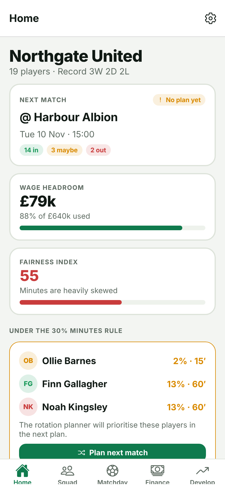

*The Gaffer home screen, loaded with the demo club.*

**What to do**

- Start with the home screenshot or the first frame of the full video on screen.

**What to say**

> Picture a Saturday morning. A parent walks up to the coach and asks why their son only played twenty minutes. The coach doesn’t have a good answer. He has a group chat, a spreadsheet and a feeling.
>
> Now picture the owner on the same morning. Can we afford to keep our best player? What happens to the budget if we sign another striker?
>
> Those are the same squad and the same data, and today they live in different tools, or in nobody’s tool. Gaffer puts them in one place. I’ll show you the real app, then tell you honestly where it stands.

### 2. The problem and the landscape

**Time:** starts at 0:45, runs about 1:15
**Goal:** Show that the gap is real, using the research, without overclaiming.

**On screen**

| Segment | Examples found | What they do well | What is missing |
| --- | --- | --- | --- |
| Club admin | PlayMetrics, TeamSnap, SportsEngine, Spond, 360player | Registration, payments, scheduling, parent messaging | Little help with selection, fairness or development |
| Video and AI analysis | XbotGo Pro Soccer, Veo, Hudl | Cheaper tagging and highlights | Tied to a camera, separate from selection and budget |
| Load and wellness | Catapult, Kitman, Playermaker, AthleteMonitoring | Workload and injury risk | Professional pricing, hardware, weak youth evidence |
| Squad and finance planning | Only an academic paper turned up | Not applicable | No product found for non-professional clubs |

**What to do**

- Show the table. Do not read every cell. Point at the last row.

**What to say**

> Before building anything I looked at what already exists. The market splits into four groups: club administration, video analysis, player load and wellness, and squad planning.
>
> Administration is crowded, and it is consolidating. One comparison site reports that Sports Connect merged with PlayMetrics in 2025 and that PlayMetrics acquired SportsEngine in May 2026. Video analysis is getting cheaper fast. XbotGo launched an AI match-analysis feature for amateur clubs in September.
>
> The row I care about is the last one. In my research I found no product that connects playing time, the wage budget and player development for clubs below the professional level. That is a finding from a limited search, not a proven market gap, and I’ll say what I’d do to validate it at the end.
>
> The pain points are consistent across what I read. Group chats turn chaotic. Volunteer coaches track minimum playing time in spreadsheets. And the popular apps are described as having no development tracking. Most of that evidence comes from vendor blogs and one forum post, so I treat it as a signal, not as data.

### 3. What Gaffer is

**Time:** starts at 2:00, runs about 0:40
**Goal:** Give the one-sentence pitch and show it is one product on three platforms.

**On screen**

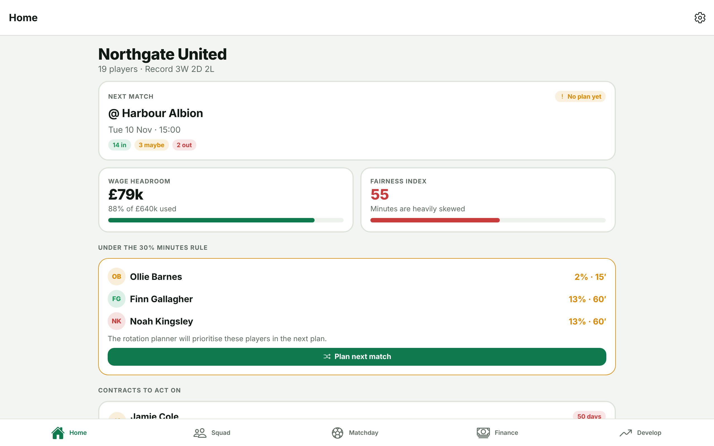

*The same app at desktop width in a browser. It is built as one codebase for iOS, Android and the web.*

**What to do**

- Show the desktop screenshot, then the phone screenshots in the gallery.

**What to say**

> Gaffer is one app, built once, for iOS, Android and the web. Here it is at desktop width in a browser.
>
> It rests on three ideas. First, fair playing time is a number the club can set and the software can enforce. Second, the owner’s view and the coach’s view come from the same data. Third, development is logged as observations over time, so progress is a trend and not an opinion.
>
> Four short demos follow. Each one answers a question someone at the club asks every week.

### 4. Demo 1: Fair playing time

**Time:** starts at 2:40, runs about 1:30
**Goal:** Land the core idea: a rule, an alert and a plan that keeps the rule.

**On screen**

▶ **[Demo 1: Fair playing time (1:20)](media/video/1-fair-playing-time.mp4)**  
[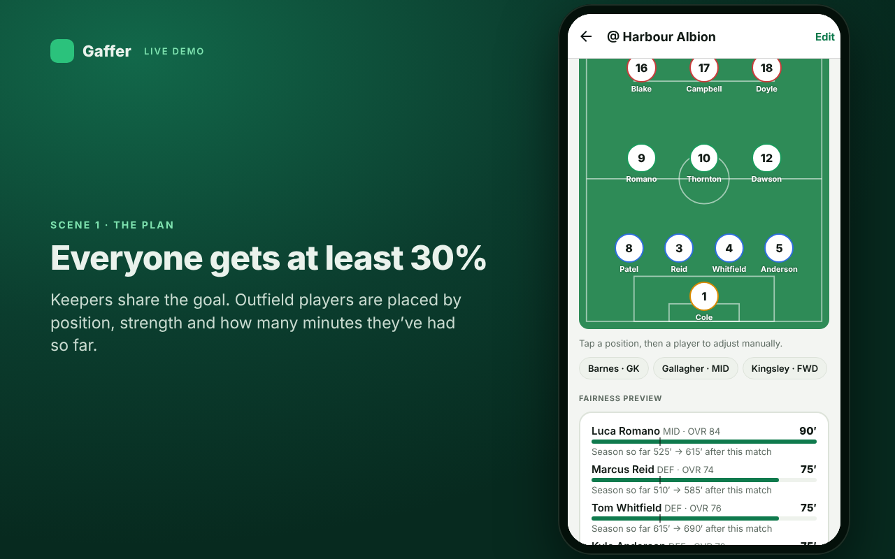](media/video/1-fair-playing-time.mp4)

**What to do**

- Play the “fairness” clip full screen.
- Pause at the alert card (about the third caption) and point to the three players under the minimum.
- Pause on the fairness preview at the end and point to the marker.

**What to say**

> This is the demo club, Northgate United, with a season of results already in it. The home screen shows a fairness index built from every minute played. It reads 55 out of 100, which means minutes are heavily skewed.
>
> Gaffer lists the players who have been available but are below the club’s minimum share. The second goalkeeper has played two percent of the available time. Two others are at thirteen percent. The club rule here is thirty.
>
> I tap “Plan next match”, confirm who is available, and generate the plan. The planner does three things. Goalkeepers share the goal and outfield players never go in it. Everyone available is guaranteed the minimum. And the extra minutes go first to the players who have had the least, or to the strongest players if the coach chooses a more competitive approach.
>
> The pitch shows each substitution window. Players coming on are tagged, and the changes are listed. Finally the preview shows every player against the club’s minimum, marked by the line. Nobody falls under it.

### 5. Demo 2: Match day

**Time:** starts at 4:10, runs about 1:36
**Goal:** Show that the plan survives contact with a real match, and that parents get a factual answer.

**On screen**

▶ **[Demo 2: Match day (1:26)](media/video/2-match-day.mp4)**  
[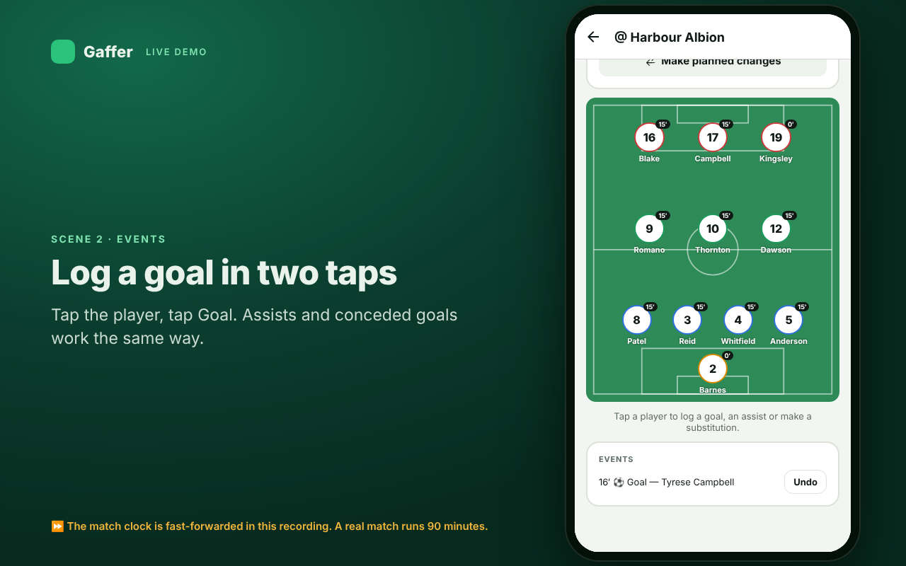](media/video/2-match-day.mp4)

**What to do**

- Play the “live” clip.
- Mention the on-screen note that the clock is fast-forwarded. A real match runs 90 minutes.
- Pause on the parent message at the end and read the first two lines of it aloud.

**What to say**

> On match day the same plan runs the game. One tap starts the clock. At fifteen minutes Gaffer flags that a substitution window is due and shows who comes on and who goes off. One tap makes the changes.
>
> Goals and assists take two taps: tap the player, tap Goal. For this recording I fast-forward the clock, because a real match is ninety minutes.
>
> At full time the minutes are saved exactly and the season ledger updates by itself. Bars show every player against the minimum.
>
> And here is the conversation from the opening. Say the second goalkeeper’s parent asks why he only played half the match. The coach taps Explain and gets a factual message: 45 of 90 minutes, eight percent of the season’s available time, 17th of 19 in the squad for minutes, the club’s thirty percent rule, and a promise that he will be prioritised in upcoming matches. It’s the answer the coach never had on that Saturday morning.

### 6. Demo 3: The owner’s view

**Time:** starts at 5:46, runs about 1:20
**Goal:** Show that the same data answers the owner’s questions.

**On screen**

▶ **[Demo 3: The owner’s view (1:10)](media/video/3-owners-view.mp4)**  
[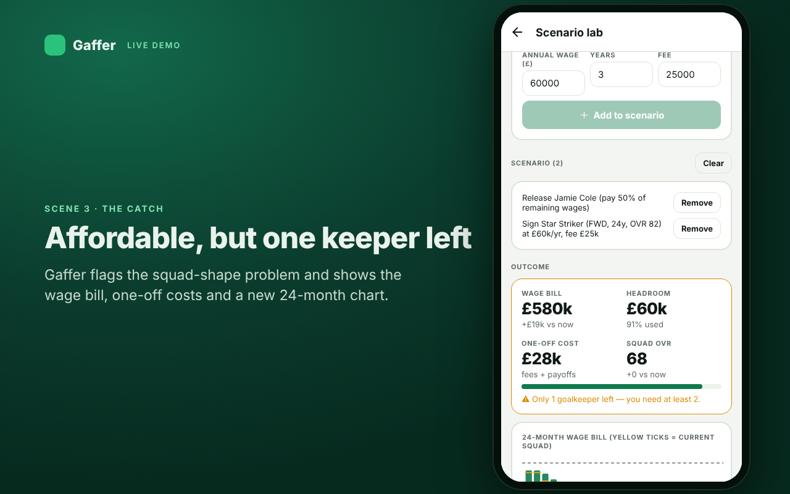](media/video/3-owners-view.mp4)

**What to do**

- Play the “owner” clip.
- Pause on the 24-month chart and trace the falling bars with your finger or cursor.
- Pause on the scenario outcome and point to the keeper warning.

**What to say**

> Now the owner. The Finance tab shows the wage bill against the annual budget. Eighty-eight percent is committed.
>
> This chart looks 24 months ahead. Each bar is the monthly wage bill. As contracts expire the bars fall, so the owner can see room to invest and the cliffs where several contracts end together. Below it, the retention list ranks good players with short contracts.
>
> The scenario lab is where decisions get tested. Here I release the first-choice goalkeeper and sign a striker on sixty thousand a year. On paper that looks affordable. Gaffer shows the new wage bill and one-off costs, and it warns that only one goalkeeper is left. That is a squad problem no budget spreadsheet would catch.

### 7. Demo 4: Player development

**Time:** starts at 7:06, runs about 1:18
**Goal:** Show that the coach’s notes turn into a trend and a shareable report.

**On screen**

▶ **[Demo 4: Player development (1:08)](media/video/4-player-development.mp4)**  
[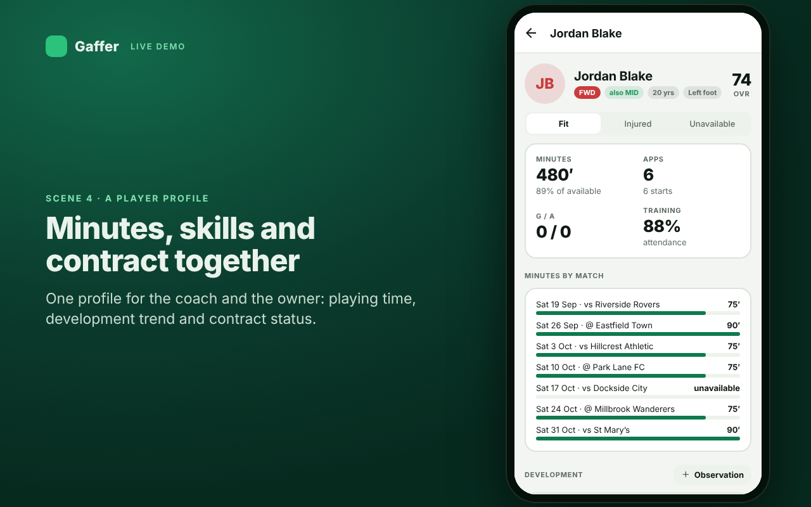](media/video/4-player-development.mp4)

**What to do**

- Play the “develop” clip.
- Pause on the progress report at the end.

**What to say**

> The Develop tab looks across the whole squad and suggests what to train, based on the weakest skill. It also tracks individual focus goals.
>
> Each player has one profile with playing time, skills, contract and trend. After a session the coach logs an observation: adjust a few ratings, add a note. The trend and the projection update.
>
> From there one tap writes a progress report, with strengths, areas to grow, focus goals and playing time, ready to send to the player or a parent.

### 8. How it was built

**Time:** starts at 8:24, runs about 0:45
**Goal:** Establish credibility. Facts only.

**On screen**

| Fact | Detail |
| --- | --- |
| Platforms | iOS, Android and web from one TypeScript codebase (Expo and React Native) |
| Size | About 4,900 lines across 32 source files, 15 screens |
| Core logic | Pure TypeScript with 21 unit tests (rotation planner, budget and scenarios, live clock, fairness) |
| Checks run | Type check and lint clean, tests passing, and a scripted browser walkthrough with no console errors |
| How | Built in one working session with an AI coding agent, then verified by tests and by watching the app run |

**What to do**

- Show the table. Spend a few seconds on the core logic row.

**What to say**

> A word on how this was built. It is one TypeScript codebase for iOS, Android and the web: about 4,900 lines, 15 screens.
>
> The part I care about most, the fairness planner, is plain tested code, not a screen. It has 21 unit tests covering the rotation planner, the budget and scenario maths, the live match clock and the season fairness figures.
>
> It was built in a single working session with an AI coding agent. Testing the app in a browser caught real problems along the way, for example a second goalkeeper being placed at right-back. Those are fixed and covered by tests.

### 9. Where it stands, honestly

**Time:** starts at 9:09, runs about 0:40
**Goal:** Pre-empt the hard questions by stating the limits first.

**On screen**

| Status | What |
| --- | --- |
| Built and checked | Squad, matchday, finance and development workflows; fairness planner; live match; scenarios; progress reports; demo club; backup and restore |
| Built, not yet checked | Running on real iPhones and Android phones. The web build was tested in a browser at phone size only |
| Not built | Accounts and cloud sync, push notifications, parent-facing app, payments and registration, multiple teams, import from spreadsheets |
| Caveats | Data lives on the device. Ratings projections are simple age-curve heuristics. Research is mostly vendor material. Store bundle IDs are placeholders |

**What to do**

- Show the table. Say the “not built” row slowly.

**What to say**

> Here is where it stands. The workflows you just saw are built and checked. Running on real iPhones and Android phones is the next thing to verify. I tested the web build in a browser at phone size, not on devices.
>
> What isn’t built: accounts and cloud sync, push notifications, anything parent-facing, payments and registration, and multiple teams. Right now the data lives on the device, with backup and restore.
>
> The age-based projections are simple heuristics, and the research behind this is mostly vendor material. So this is a working product slice that proves the idea, not a launch-ready product.

### 10. What I need from you

**Time:** starts at 9:49, runs about 0:45
**Goal:** Turn the demo into decisions.

**On screen**

| Decision | Why it matters | My suggestion |
| --- | --- | --- |
| Which clubs first: youth, amateur or semi-pro? | It sets defaults, language and the privacy bar | Start with one level. Youth has the strongest fairness story; semi-pro has the strongest budget story |
| Pilot with 2 or 3 real clubs | Validates the research and the live-match workflow | Pick clubs where a coach and an owner both attend the review |
| Backend, hosting and data privacy | Youth data (names, birth dates, guardians) needs consent and clear retention rules | Get a privacy review before any real data is entered |
| Business model | Not decided in this project | Test pricing in the pilot: per club by squad size, with the budget module as an add-on |
| Compete with or integrate with admin platforms | Registration and payments are not built | Integrate first; revisit after the pilot |

**What to do**

- Show the table. Ask for a decision on the first two rows before you leave the meeting.

**What to say**

> I’d like five decisions from this meeting, and the first two matter most.
>
> One: which kind of club do we start with? Youth has the strongest fairness story. Semi-pro has the strongest budget story. I’d pick one.
>
> Two: can we line up two or three pilot clubs? The research tells me where to look, but only real coaches will tell us whether they’d run a match from this.
>
> The other three are privacy and hosting, the business model, and whether we integrate with the administration platforms or compete with them. My suggestions are on the screen, but none of them is decided in this project.

### 11. Close

**Time:** starts at 10:34, runs about 0:20
**Goal:** End on the one-line value and open the floor.

**On screen**

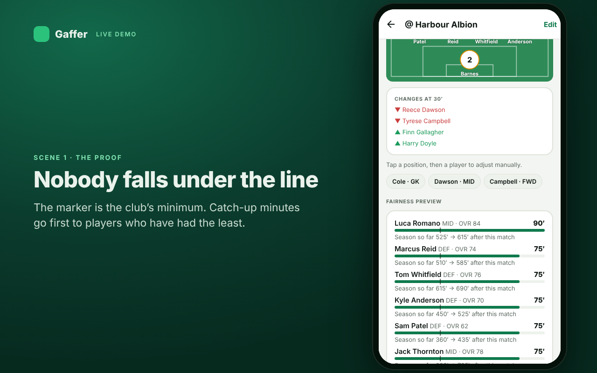

*The fairness preview: every player against the club’s minimum.*

**What to do**

- Leave the fairness preview image on screen during questions.

**What to say**

> To close: the coach gets a plan that keeps the club’s promise on playing time. The owner gets a budget that can be tested before money is spent. Both work from one squad, in one app.
>
> I’d be glad to take questions, and I can run any scene live.

## Questions you may get

**How is this different from TeamSnap, PlayMetrics or Spond?**  
Those products run administration: registration, payments, scheduling and parent messaging. In my research they did not connect playing time, the wage budget and development tracking. Gaffer focuses on that gap. It does not yet do registration or payments, so the realistic first step is to sit alongside them. I did not review every product in depth.

**Is this real or a mock-up?**  
It is real running code. The clips are the actual app. The club, players and results are generated demo data. The core logic has 21 automated tests and I walked through the app in a browser.

**Does it work on phones?**  
It is built as one codebase for iOS, Android and the web. I tested the web build in a browser at phone size. I have not yet run it on physical devices. That is the next verification step, using cloud builds.

**Where does the data live, and is it safe?**  
Today it stays on the device the app runs on, with export and restore. There are no accounts or cloud sync yet. Because clubs would enter children’s names, birth dates and guardian details, I want a privacy and legal review before any real club uses it.

**How do we make money?**  
Not decided. Options to test in a pilot: a subscription per club based on squad size, with the budget and scenario module as an add-on for semi-professional clubs.

**How accurate are the ratings and projections?**  
Ratings are entered by the coach, so they are as good as the coach’s observations. The two-year projection is a simple age-curve heuristic, labelled that way in the app. We would calibrate it with real data from the pilot.

**Will a coach really use this on the touchline?**  
That is the main thing a pilot should test. The live screen is designed for quick taps, but I have not watched a coach use it during a real match.

**How long until a pilot?**  
I would rather size it with the team than quote a date. The work includes accounts and sync, notifications, device builds and testing, a privacy review, and an onboarding path for existing squads.

**What about video and GPS analysis?**  
Out of scope on purpose. Those tools are good at what they do. A later version could import their output into a player’s development record.

## Appendix

### Screenshots

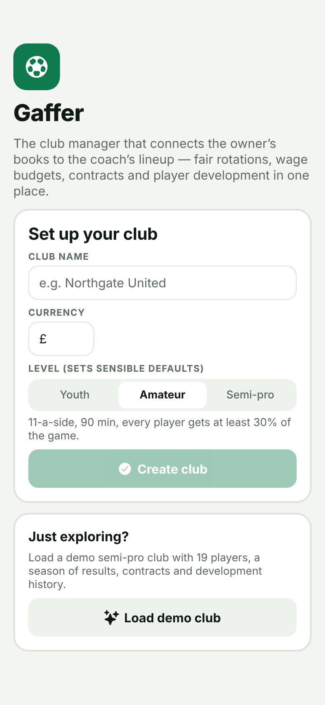  
*Welcome and club setup*

  
*Home: next match, wage headroom, fairness index*

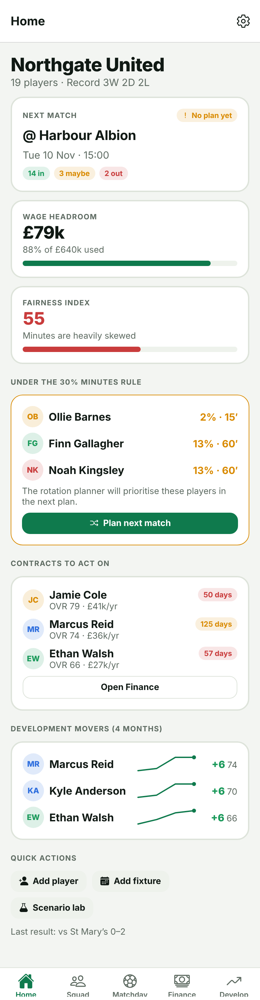  
*Home, full page*

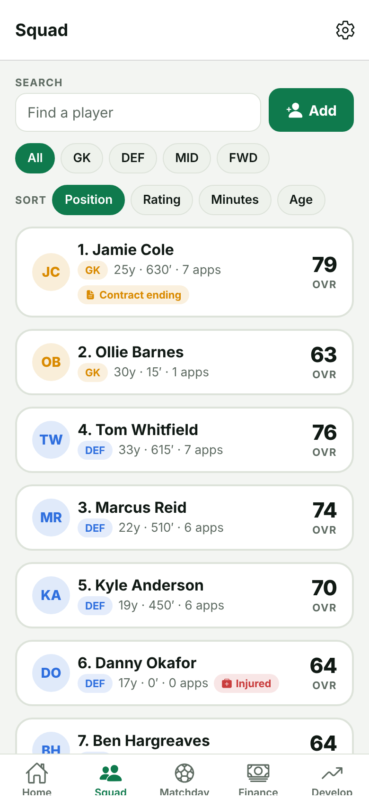  
*Squad list with minutes and contract flags*

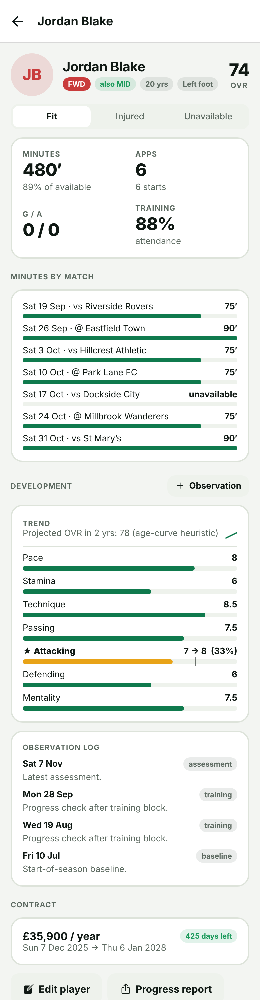  
*Player profile: minutes, skills, trend, contract*

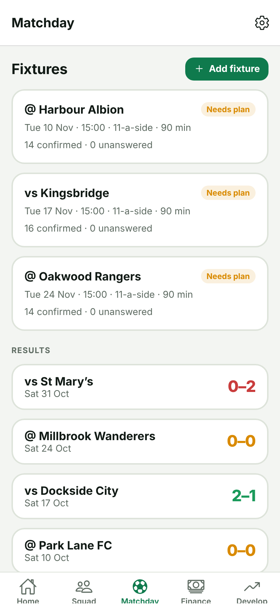  
*Matchday: fixtures, results and training*

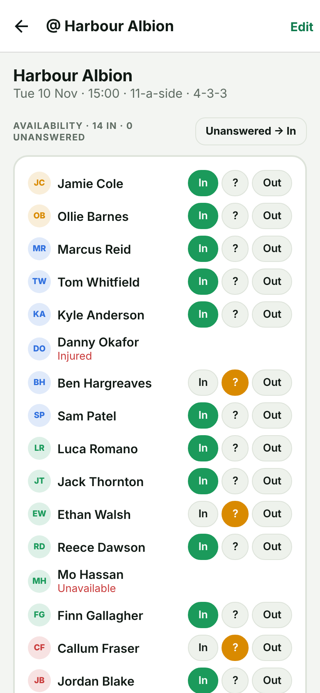  
*Availability for the next match*

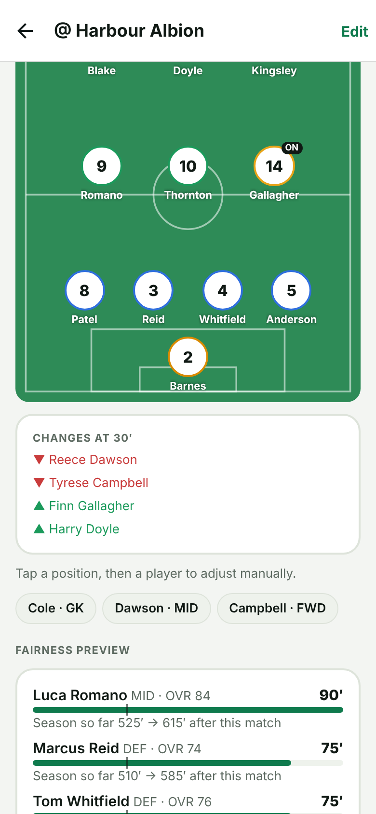  
*Rotation plan with substitutions at 30 minutes*

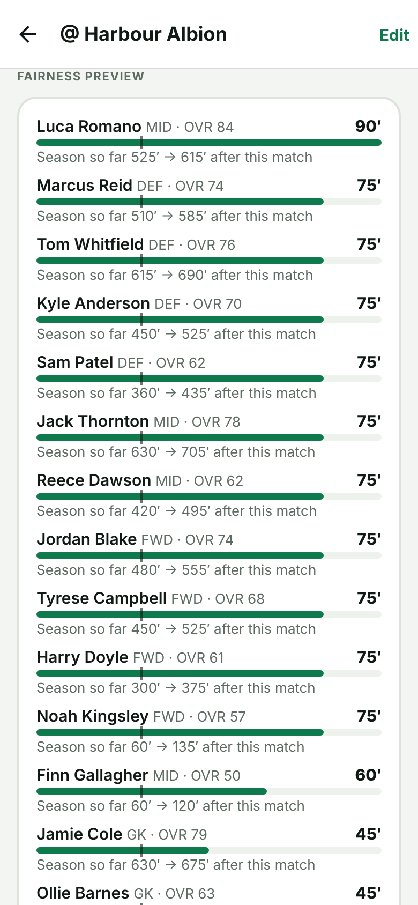  
*Fairness preview against the club minimum*

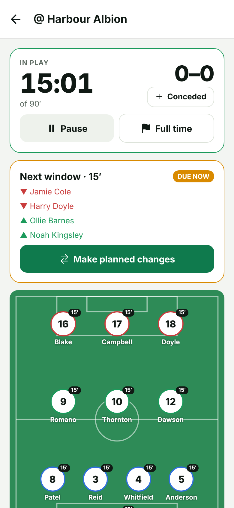  
*Live match: a substitution window is due*

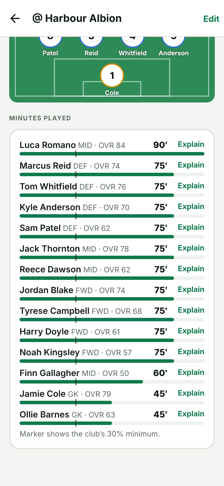  
*Minutes played after full time*

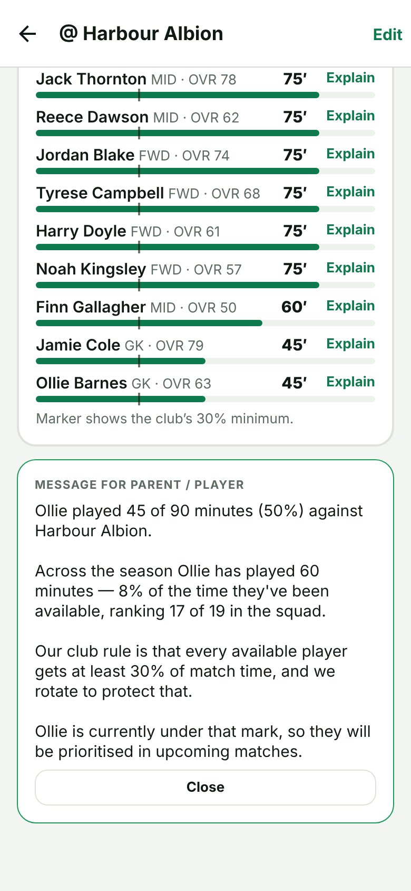  
*Parent explainer message*

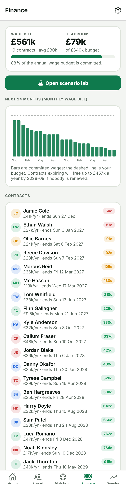  
*Finance: wage bill, 24-month chart, contracts, squad shape*

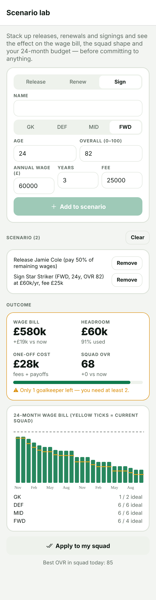  
*Scenario lab: release a keeper, sign a striker*

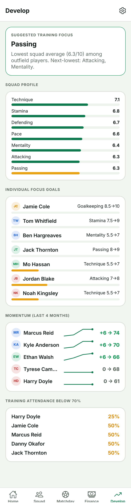  
*Develop: suggested focus, squad profile, momentum*

  
*Web: home at desktop width*

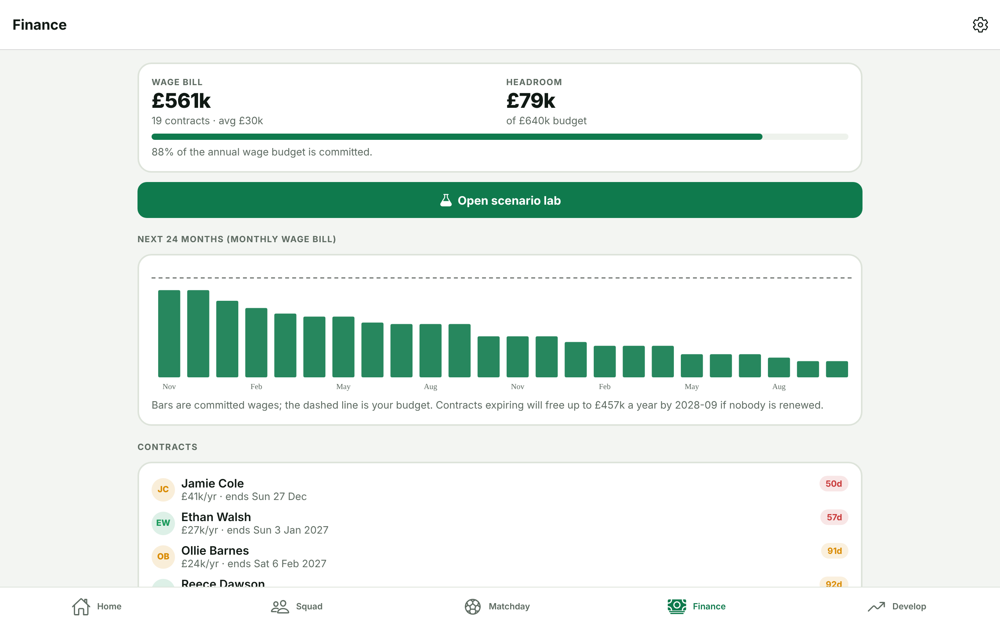  
*Web: finance at desktop width*

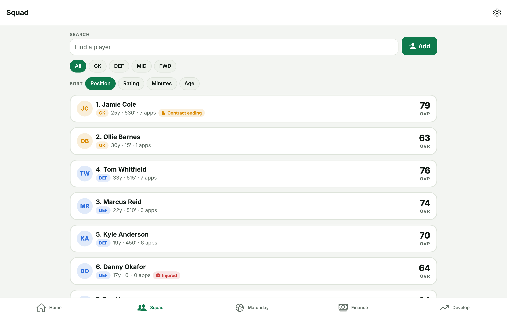  
*Web: squad at desktop width*

### What we did, start to finish

- **Research.** Five searches covering club-management software, owner-side tools, coach and parent pain points, AI video analysis and load monitoring. Result: the segments are siloed, and no product was found that connects playing time, budget and development below the professional level. Evidence quality is mixed and mostly from vendors.
- **Concept.** Gaffer: fair rotations plus wage budgeting plus development tracking, on iOS, Android and web from one codebase. Chosen so the owner’s and coach’s views share one dataset.
- **Foundation.** Expo, React Native and TypeScript with Expo Router (the project’s own convention). Local-first storage with backup and restore.
- **Core logic first.** Rotation planner (minute quotas plus Hungarian assignment), live match clock, season fairness figures, wage budget and scenario engine, ratings and projections, progress reports, demo-data generator. Covered by unit tests.
- **Screens.** 15 screens: welcome, five tabs (Home, Squad, Matchday, Finance, Develop), player profile, edit and observe, fixture plan, edit and live, training, scenario lab and settings.
- **Verification.** Type check, lint, unit tests, a production web build, and scripted browser walkthroughs with screenshots. These caught real bugs, listed below.
- **Delivered.** Committed and pushed to the repository branch with a README. This presentation kit was added afterwards.

### Problems the testing caught

- Demo contracts could start in the future, which understated the wage bill. Fixed.
- The demo season did not produce any fairness alerts, so the main feature looked idle. The demo now simulates a coach who favours the best XI.
- A second goalkeeper was being placed at right-back. Keepers and outfield players now have separate minute pools, with a test.
- The plan looked wrong when too few players were marked as available. Added a “count the maybes” switch and a clear warning.
- A substitution made a few seconds late made a player look under the minimum. Added one minute of tolerance.
- A hooks-order error on the fixture screen and several lint warnings. Fixed.

### Sources for the market slide

- [PlayMetrics vs TeamSnap comparison (consolidation: Sports Connect, SportsEngine)](https://www.softwareadvice.com/sports-league-management/playmetrics-profile/vs/teamsnap/)
- [XbotGo Pro Soccer launch, September 2026](https://techbuzzireland.com/2026/09/06/xbotgo-launches-pro-soccer-globally-at-ifa2026/)
- [TeamStats: coordinating coaches, players and parents (vendor blog)](https://www.teamstats.net/blog/coordinating-coaches-players-and-parents-seamlessly)
- [TeamStats: top apps for grassroots football (vendor blog)](https://www.teamstats.net/football-coaching/apps/top-apps-for-grassroots-football-teams-in-2025)
- [Volunteer coach thread on tracking minimum playing time (forum mirror, single anecdote)](https://reddit.birdcat.cafe/r/SoccerCoachResources/comments/1m7pzfi/grow_your_team_without_spreadsheets)
- [Squad planning research paper (Galaz-Cares, via StatsBomb)](https://blogarchive.statsbomb.com/uploads/2024/10/Optimizing-Football-Squad-Planning-Balacing-Competitivo-Success-and-Financial-Sustanabilty-GalazCares24.pdf)
- [AthleteMonitoring (youth load and wellness)](https://www.athletemonitoring.com/?p=32301)

These came from a limited set of searches. Several are vendor blogs or comparison sites. Verify any figure before quoting it outside this meeting.

### Run it yourself

Code: https://github.com/thehaseebshah/soccer-manager/tree/claude/magical-volta-414s0d

`npm install` then `npm run web`, then tap "Load demo club". The recordings are reproducible with the scripts in `demo/`: start the server (`node demo/serve.js`), then run `demo/record.js` and `demo/screenshots.js` with Playwright installed.
